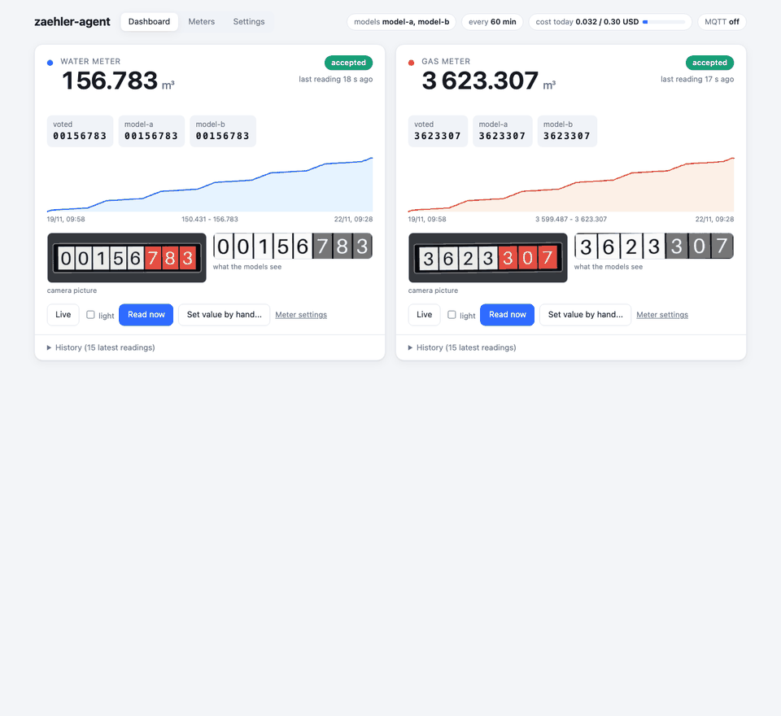
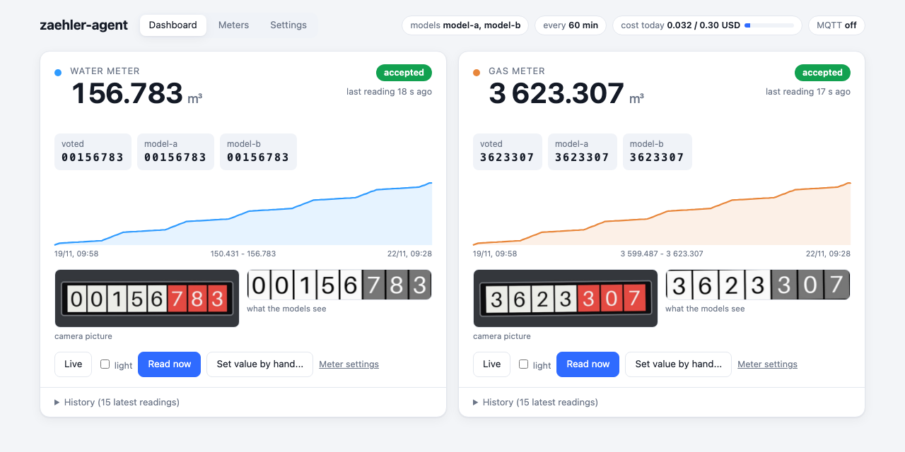
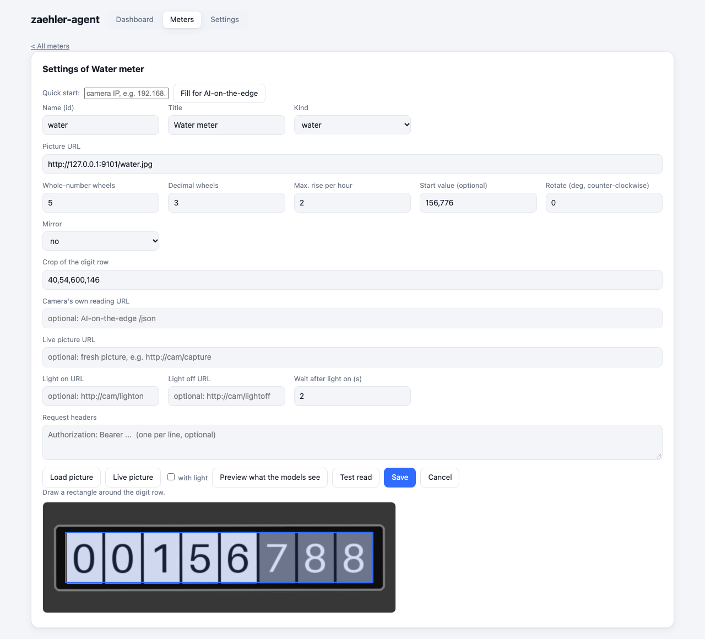
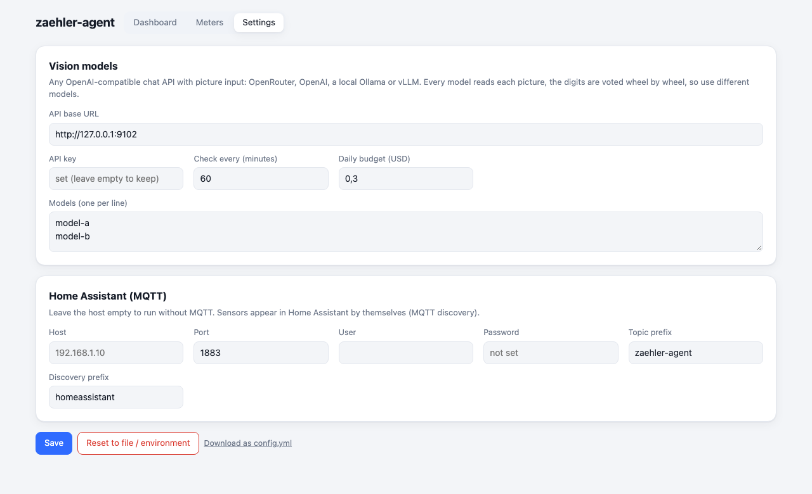
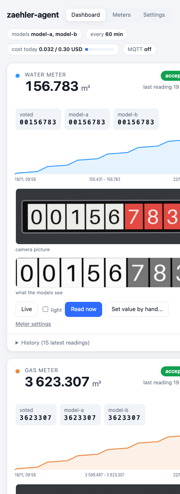

# ZaehlerAgent

[](https://github.com/DominikLudwig1995/ZaehlerAgent/actions/workflows/ci.yml)
[](https://github.com/DominikLudwig1995/ZaehlerAgent/releases)
[](LICENSE)
[](pyproject.toml)

**Read the old mechanical gas, water, electricity or heat meter in your basement with a vision model, and get a
reliable `total_increasing` sensor in Home Assistant.**

*"Zähler" is German for meter or counter.*



## The problem

Many meters are purely mechanical: a row of digit wheels, no pulse output, no smart interface. The usual fix is a
cheap camera (for example an ESP32-CAM running [AI-on-the-edge-device](https://github.com/jomjol/AI-on-the-edge-device))
that reads the wheels with a tiny neural network. In practice that network struggles with glare, blurry wheels and
wheels caught half-way between two digits, and the reported value jumps around or stops for weeks.

## What this does

ZaehlerAgent takes the picture your camera already produces and reads it with **several vision models**
(OpenRouter, OpenAI, a local Ollama or vLLM, anything OpenAI-compatible). Their answers are **voted wheel by wheel**
and then checked against the last value: *a meter never goes down and never runs faster than its pipe allows.* A
reading that violates this is dropped instead of published. What reaches Home Assistant is a clean, monotonic
value that works in the energy dashboard.

- **Reliable**: multi-model vote plus plausibility check. See [how it works](docs/how-it-works.md).
- **Set up in the browser**: add cameras, draw the digit row on the live picture, test a reading, done. No YAML needed.
- **Home Assistant native**: MQTT discovery, one sensor per meter, energy dashboard ready.
- **Camera agnostic**: any URL that returns a picture. Optional live picture with the camera's light.
- **Observable**: web UI, history, Prometheus metrics, daily cost budget.
- **Small**: one container, SQLite, around 100 MB of memory.

## Try it in two minutes

With docker compose:

```bash
git clone https://github.com/DominikLudwig1995/ZaehlerAgent && cd ZaehlerAgent
docker compose up -d
```

Open <http://localhost:8000>, then:

1. **Settings**: enter your API key (any OpenAI-compatible vision API), pick two or more models, enter your MQTT broker.
2. **Meters → Add meter**: enter the camera's picture URL, press *Load picture*, draw a rectangle around the digit
   row, *Test read*, *Save*.

The sensor shows up in Home Assistant by itself. Details: [deployment](docs/deployment.md) and
[Home Assistant](docs/home-assistant.md).

**No camera and no API key?** Run the demo, a fake camera and fake models with seeded history:

```bash
uv sync && uv run python scripts/demo.py     # http://127.0.0.1:8000
```

## Screenshots

| Dashboard | Meter setup |
|---|---|
|  |  |

| Settings | On the phone |
|---|---|
|  |  |

## Documentation

| | |
|---|---|
| [How it works](docs/how-it-works.md) | The pipeline, the vote, the plausibility rules, why it is reliable |
| [Configuration](docs/configuration.md) | UI, config file, environment variables, every meter setting |
| [Home Assistant](docs/home-assistant.md) | Discovery, entities, the energy dashboard, MQTT topics |
| [Deployment](docs/deployment.md) | docker compose, reverse proxy and login, Nomad, Prometheus, upgrades |
| [API and metrics](docs/api.md) | HTTP endpoints, Prometheus metrics, example alerts |
| [Accuracy](docs/accuracy.md) | Measured comparison of models against a camera's own network |
| [Troubleshooting](docs/troubleshooting.md) | Rejected readings, bad crops, MQTT, costs |
| [Development](docs/development.md) | Setup, tests, release process |

## Security

The web UI has **no login of its own**. It can change settings, store an API key and switch a camera's light. Do not
expose it to the internet; put it behind a reverse proxy with authentication (see
[deployment](docs/deployment.md#access-control)) or run it read-only with `READ_ONLY=true`. Report vulnerabilities
as described in [SECURITY.md](SECURITY.md).

## Contributing

Issues and pull requests are welcome, see [CONTRIBUTING.md](CONTRIBUTING.md). Release notes are in the
[changelog](CHANGELOG.md).

## License

[MIT](LICENSE)
